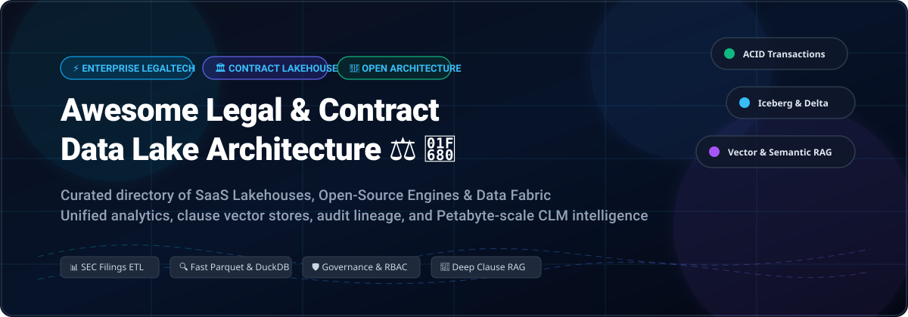

# ⚖️ Awesome Legal & Contract Data Lake Architecture 🚀

**A curated list of Enterprise SaaS platforms, Hosted Lakehouse engines, and Open-Source frameworks for architecting Legal, Contract Lifecycle Management (CLM), SEC EDGAR, and Clause Analytics Data Lakes.**

[Sector Overview](#-sector-overview--market-dynamics) • [SaaS & Hosted Platforms](#-saas--hosted-data-lake-platforms) • [Open-Source Solutions](#-open-source-data-lake--analytics-engines) • [Architecture Blueprint](#-legal-contract-lakehouse-architecture-blueprint) • [Contributing](#-contributing)

---

## 📌 Executive Summary & SEO Overview

Modern enterprise legal departments, general counsel offices, and compliance teams handle millions of complex unstructured documents—including MSAs, NDAs, DPAs, SLAs, credit agreements, procurement schedules, and SEC 10-K/10-Q filings. A **Legal & Contract Data Lakehouse** merges the scale and schema flexibility of object storage data lakes (Amazon S3, Azure Data Lake Storage Gen2, Google Cloud Storage) with transactional ACID guarantees (Apache Iceberg, Delta Lake), semantic clause search (Vector Databases), and cross-system federated SQL querying.

Whether migrating away from legacy siloed Contract Lifecycle Management (CLM) repositories or engineering an enterprise-grade Legal AI and RAG pipeline, this catalog details both industry-leading managed SaaS solutions and high-performance open-source building blocks.

---

## 📈 Sector Overview & Market Dynamics

> The global legal technology and contract analytics data lake sector is valued at approximately **$32.5 Billion** (incorporating enterprise CLM, legal AI, and cloud data lake architectures) and is projected to expand at an annual growth rate (CAGR) of **14.2%** through 2032. 
> 
> The sector exhibits **moderate fragmentation across specialized domain applications** (with best-of-breed legal AI and contract intelligence providers like Icertis, Ironclad, and Robin AI competing on deep domain workflows) alongside **strong concentration and winner-take-most dynamics in foundational infrastructure layers**, where hyperscalers (Microsoft, Google Cloud, AWS) and unified cloud lakehouse giants (Snowflake, Databricks) capture the vast majority of enterprise data storage, governance, and petabyte-scale compute.

---

## 🏢 SaaS & Hosted Data Lake Platforms

The table below catalogs enterprise SaaS data platforms, cloud-native contract data lakehouses, and managed federated query engines. Entities are sorted in descending order by **Company Scale (Market Cap / Enterprise Valuation)**.

| SaaS / Hosted Platform | Company Scale (Valuation / Market Cap) 🏢 | Primary Legal & Contract Data Lake Focus 📑 | Specific Starting Pricing 💳 | Free Tier / Trial Limits ⏱️ |
| :--- | :--- | :--- | :--- | :--- |
| **[Microsoft Fabric](https://www.microsoft.com/en-us/microsoft-fabric)** | ~$3.1 Trillion (Public: MSFT) | End-to-end unified lakehouse platform with OneLake, multi-cloud contract ingestion, Synapse analytics, and Microsoft 365 Copilot legal integration. | **$0.36 per capacity hour** (~$262.80/month for F2 pay-as-you-go capacity); storage starts at **$0.023/GB/month** on OneLake. | **60-day free trial** with up to 64 Capacity Units (CU) of compute and 1 TB of OneLake storage capacity. |
| **[Google Cloud BigQuery](https://cloud.google.com/bigquery)** | ~$2.1 Trillion (Public: GOOGL) | Serverless enterprise data warehouse and lakehouse engine supporting BigLake, multimodal Gemini legal document parsing, and unstructured vector search. | **$6.25 per TB** scanned for on-demand queries; BigLake multi-cloud storage at **$0.02 per GB/month** (active). | **Free forever tier**: First **1 TB of SQL query analysis** and **10 GB of active storage** free each month; plus $300 credit 90-day trial for new accounts. |
| **[AWS Lake Formation](https://aws.amazon.com/lake-formation/)** | ~$2.1 Trillion (Public: AMZN) | Centralized contract data lake governance, fine-grained cell/column-level access control, and integration with AWS Glue, Athena, and Amazon S3. | **$0.00 base charge** for Lake Formation itself; underlying Glue Crawlers cost **$0.44 per DPU-Hour**; Athena queries cost **$5.00 per TB** scanned. | **Free forever tier**: AWS Lake Formation console and security policies free; AWS Free Tier includes **10 GB S3 storage**, **1 million AWS Lambda requests**, and Glue 1 million free catalog requests/month for 12 months. |
| **[Teradata Vantage](https://www.teradata.com/products/vantagecloud)** | ~$3.2 Billion (Public: TDC) | VantageCloud enterprise analytics and ClearScape Analytics engine for structured legal risk analytics and regulatory audit trail modeling. | **$1.68 per Vantage Compute Unit (VCU) hour** on VantageCloud Lake; base departmental production clusters start at **$3,500/month**. | **30-day free trial** providing $300 cloud credit with pre-loaded financial/contract sample datasets and ClearScape analytics access. |
| **[Snowflake](https://www.snowflake.com/)** | ~$52 Billion (Public: SNOW) | Cloud data lakehouse offering native Apache Iceberg table support, Snowpark container services for LLMs, and secure data sharing across outside legal counsel. | **$2.00 per Snowflake Credit** on Standard Edition; Enterprise Edition at **$3.00 per credit**; storage at **$23.00 per TB/month** (compressed). | **30-day free trial** including **$400 in free usage credits** across AWS, Azure, or GCP with full Enterprise feature access. |
| **[Databricks](https://www.databricks.com/)** | ~$43 Billion (Private Valuation) | Unified Data Intelligence Platform built on Delta Lake and Unity Catalog with legal LLM fine-tuning, MLflow, and multi-tenant document extraction. | **$0.07 per Databricks Unit (DBU)** for Jobs Light compute; **$0.15 per DBU** for standard Data Engineering; **$0.22 per DBU** for SQL Serverless. | **14-day full platform free trial** on AWS, Azure, or GCP (customer provides cloud infrastructure account). |
| **[Cloudera](https://www.cloudera.com/)** | ~$5.3 Billion (Private Valuation) | Enterprise open data lakehouse (CDP) supporting Apache Iceberg, Ozone object storage, hybrid cloud compliance, and air-gapped legal deployments. | **$0.08 per Cloudera Compute Unit (CCU) hour** on CDP Public Cloud; minimum on-demand consumption bundles start at **$750/month**. | **60-day free trial** of Cloudera Data Platform (CDP) Private Cloud Base with sample workloads and hybrid deployment guides. |
| **[Icertis Data Lake Foundation](https://www.icertis.com/)** | ~$5.0 Billion (Private Valuation) | Domain-specific contract intelligence platform turning unstructured contract repositories into structured relational lakehouse schemas with CLM AI copilots. | **$30.00 to $60.00 per user/month** (Enterprise Tier, minimum annual commit of **$36,000/year** based on volume of managed contracts). | **No permanent free tier**; qualified enterprise prospects receive a **30-day structured Proof-of-Concept (PoC)** sandbox with up to 500 contract ingestion parsing credits. |
| **[Starburst Galaxy](https://www.starburst.io/platform/starburst-galaxy/)** | ~$3.3 Billion (Private Valuation) | Fully-managed Trino distributed SQL query engine for cross-cloud federated analytics across decentralized legal repos, SharePoint, and S3 without data movement. | **$0.35 per Starburst Credit** for Standard Clusters; **$0.55 per Credit** for Enterprise Clusters with automated warp speed indexing. | **$500 free usage credit valid for 30 days** upon signup with no upfront software license fee. |
| **[Dremio](https://www.dremio.com/)** | ~$2.0 Billion (Private Valuation) | Unified lakehouse platform and Apache Arrow-powered query acceleration layer with native Nessie catalog and Git-for-data branching for legal revision histories. | **$0.39 per Dremio DCU (Data Compute Unit) hour** on Dremio Cloud Standard; Enterprise tier starts at **$0.59 per DCU hour**. | **Forever-free community control plane** (Dremio Cloud Free Edition has no software licensing charge for query planning; pay only for cloud compute nodes). |

---

## 💻 Open-Source Data Lake & Analytics Engines

A comprehensive collection of open-source engines powering legal contract storage, schema evolution, federated SQL execution, document parsing, and vector retrieval. Repositories are sorted in descending order by **GitHub Star Count (⭐)** with badges linking to their respective stargazers pages.

| Open-Source Project | GitHub Stars ⭐ | Architecture Role & Category ⚙️ | Legal & Contract Lakehouse Capability 📝 |
| :--- | :--- | :--- | :--- |
| **[RAGFlow](https://github.com/infiniflow/ragflow)** |  | Deep Document Understanding & RAG | Specialized deep vision parsing for legal PDF contracts, tables, signature blocks, and nested legal clauses with grounded citation retrieval. |
| **[ClickHouse](https://github.com/ClickHouse/ClickHouse)** |  | Columnar Real-time Analytical DBMS | Ultra-low latency SQL queries over extracted contract metadata, clause drift audit logs, and counterparty operational metrics. |
| **[Milvus](https://github.com/milvus-io/milvus)** |  | Distributed Cloud-Native Vector DB | Scalable billion-scale vector indexing of contract clauses, semantic precedent discovery, and multi-tenant document isolation. |
| **[Apache Spark](https://github.com/apache/spark)** |  | Unified Big Data Processing Engine | Large-scale distributed ETL pipelines converting raw contract archives into structured Parquet/Delta formats; NLP clause entity extraction. |
| **[DuckDB](https://github.com/duckdb/duckdb)** |  | In-Process Analytical SQL Engine | Embeddable serverless SQL engine capable of running interactive analytical queries directly against S3/local Parquet and Iceberg contract files. |
| **[Qdrant](https://github.com/qdrant/qdrant)** |  | Vector Similarity Engine (Rust) | High-performance semantic vector search with rich payload-based filtering (jurisdiction, governing law, contract expiration, party name). |
| **[Chroma](https://github.com/chroma-core/chroma)** |  | AI-Native Vector Embedding Store | Lightweight, developer-first vector storage for building legal RAG assistants, clause classification prototypes, and local search pipelines. |
| **[Apache Flink](https://github.com/apache/flink)** |  | Stateful Streaming Compute Engine | Real-time event-driven streaming pipelines for live contract signing events, automated deadline triggers, and continuous compliance monitoring. |
| **[Apache Arrow](https://github.com/apache/arrow)** |  | In-Memory Columnar Data Standard | Zero-copy memory sharing and lightning-fast transport layer across Python/C++ legal NLP models, polars, and analytical databases. |
| **[Presto](https://github.com/prestodb/presto)** |  | Distributed SQL Query Engine | High-throughput distributed SQL engine for interactive queries over massive petabyte-scale legal document data lakes. |
| **[Apache Doris](https://github.com/apache/doris)** |  | Real-time Analytical MPP Database | Sub-second SQL reporting over legal operational analytics, contract turnover rates, and counterparty liability exposure dashboards. |
| **[Unstructured](https://github.com/Unstructured-IO/unstructured)** |  | Unstructured Document ETL Library | Modular pre-processing pipelines for parsing complex legacy contract PDFs, TIFFs, DOCX files, emails, and multi-column legal schedules. |
| **[Trino](https://github.com/trinodb/trino)** |  | Federated Distributed SQL Engine | Query across multiple decentralized legal stores simultaneously—joining Salesforce CLM data, Iceberg lakes, and PostgreSQL metadata tables. |
| **[Apache DataFusion](https://github.com/apache/datafusion)** |  | Extensible Rust Query Engine | Fast, in-memory query engine written in Rust using Apache Arrow, ideal for embedding custom analytical engines in legal tech software. |
| **[Apache Iceberg](https://github.com/apache/iceberg)** |  | Open Table Format for Analytics | ACID transactional format providing full schema evolution, hidden partitioning, and historical time travel over contract lifecycle states. |
| **[Delta Lake](https://github.com/delta-io/delta)** |  | Open-Source Storage Layer | ACID transactions, scalable metadata handling, and unified streaming/batch processing on top of existing cloud object storage lakes. |
| **[Apache Hudi](https://github.com/apache/hudi)** |  | Streaming Data Lakehouse Platform | Incremental data ingestion platform with record-level upserts and deletes, crucial for GDPR "right-to-be-forgotten" contract purging. |
| **[Unity Catalog](https://github.com/unitycatalog/unitycatalog)** |  | Open Universal Data & AI Catalog | Centralized data governance, audit logging, column-level masking, and lineage tracking for files, tables, and AI models across lakehouses. |
| **[Apache Polaris](https://github.com/apache/polaris)** |  | Open Source Iceberg Catalog | Vendor-neutral catalog implementation for Apache Iceberg providing cross-engine security, credential vending, and centralized RBAC. |
| **[EDGAR Crawler](https://github.com/nlpaueb/edgar-crawler)** |  | SEC EDGAR Filings Extractor | Automated crawler designed to download and clean annual/quarterly reports (10-K, 10-Q) and material contract exhibits (Exhibit 10) for corpus building. |

---

## 🏛️ Legal Contract Lakehouse Architecture Blueprint

A standard production data lakehouse tailored for LegalTech, CLM, and contract analytics is structured into a multi-tier Medallion Architecture:

```mermaid
flowchart LR
    subgraph Ingestion["1. Multi-Modal Ingestion 📥"]
        A1["Legacy PDFs &amp; Scans"]
        A2["CLM Systems (Salesforce/Ironclad)"]
        A3["SEC EDGAR 10-K / 10-Q Filings"]
        A4["E-Signature Webhooks (DocuSign)"]
    end

    subgraph Bronze["2. Bronze Layer (Raw Archive) 🥉"]
        B1["Cloud Object Storage (S3 / ADLS / GCS)"]
        B2["Raw PDF/DOCX Blobs &amp; Original JSONs"]
        B3["Audit Log &amp; Immutable Timestamp"]
    end

    subgraph Silver["3. Silver Layer (Cleaned &amp; Enriched) 🥈"]
        C1["Unstructured / OCR Text Extraction"]
        C2["Apache Iceberg / Delta Lake Tables"]
        C3["Clause Chunking &amp; Entity Tagging"]
        C4["Vector Embeddings (Milvus / Qdrant)"]
    end

    subgraph Gold["4. Gold Layer (Business Aggregates) 🥇"]
        D1["Contract Expiration &amp; Renewal Metrics"]
        D2["Liability &amp; Indemnity Risk Indices"]
        D3["Jurisdiction &amp; Governing Law Cubes"]
    end

    subgraph Consumption["5. Downstream Applications 🚀"]
        E1["Interactive BI Dashboards (ClickHouse/Doris)"]
        E2["Legal Clause RAG &amp; AI Copilots (RAGFlow)"]
        E3["Federated SQL Queries (Trino/DuckDB)"]
        E4["Compliance Audit &amp; Data Lineage (Unity Catalog)"]
    end

    Ingestion --> Bronze
    Bronze --> Silver
    Silver --> Gold
    Gold --> Consumption
    Silver --> Consumption
```

### Key Architectural Pillars 🏛️
1. **Immutable Document Archiving**: Raw contract artifacts (PDF, Word, Scanned TIFFs) are captured verbatim into object storage with strict versioning and checksum verification.
2. **ACID Transaction Layer**: Formats like **Apache Iceberg** or **Delta Lake** provide atomic commits, schema evolution (handling changing contract classification tags over time), and time travel for regulatory audits.
3. **Hybrid Relational + Vector Storage**: Structured metadata (counterparty, effective date, governing law, total contract value) lives in columnar tables, while semantic clause representations reside in vector databases for clause drift detection and natural language Q&A.
4. **Zero-Trust Governance & Lineage**: Strict column- and row-level access control with data masking for sensitive PII/attorney-client privileged documents managed via universal catalogs like **Unity Catalog** and **Apache Polaris**.

---

## 🤝 Contributing

Contributions are always welcome! 

1. Fork this repository.
2. Create your feature branch (`git checkout -b feature/AddAwesomeEngine`).
3. Commit your changes (`git commit -m 'Add awesome legal data lake tool'`).
4. Push to the branch (`git push origin feature/AddAwesomeEngine`).
5. Open a Pull Request.

---

## 📜 License

This work is licensed under the [Creative Commons Zero v1.0 Universal (CC0 1.0)](https://creativecommons.org/publicdomain/zero/1.0/) Public Domain Dedication.
